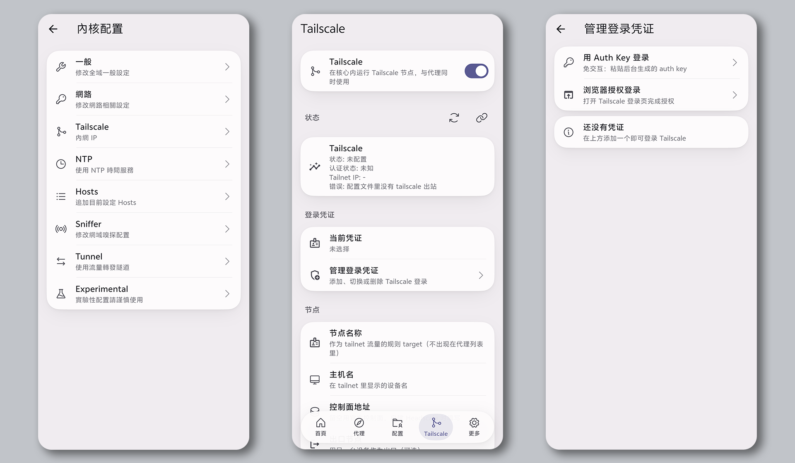

<h4 align="right">
  <strong>简体中文</strong> |  <a href="readme/README_en.md">English</a>
</h4>

<h1 align="center">⚡ BettboxMesh</h1>

  <strong>Another Better Network Toolbox (Mesh Network)</strong>

**基于[Bettbox](https://github.com/appshubcc/Bettbox)的安卓客户端分支，利用Mihomo内核自带的Tailscale、ZeroTier等组件来实现组网功能，其余功能与上游保持一致**

  

---
## 📃 简述

* Android系统中只能存在一个 VpnService，因此在启动代理软件的同时无法使用 Tailscale 这类组网工具，BettboxMesh 利用 Mihomo 内核自带的组件实现了这一功能。
* 该项目全程vibe coding完成，无法完全保证代码质量和安全性，建议审阅代码后使用
* 目前仅维护Android平台，与上游[Bettbox](https://github.com/appshubcc/Bettbox)包名不同，可同时安装，不出意外的话会持续与上游保持更新
* 更多信息请前往 [Bettbox](https://github.com/appshubcc/Bettbox) 仓库查看

---
## 🛠️ 相对上游的差异

### 1. Tailscale 内置运行
以 tsnet（userspace netstack）形式编译进内核，与代理 TUN 共用一个 VpnService，无需安装官方 Tailscale App，也不需要第二个 VPN 授权。

- tailnet 流量（`100.64.0.0/10`、`fd7a:115c:a1e0::/48`、`*.ts.net`）自动分流到内置节点
- MagicDNS：`ts.net` 域名走 tsnet 自己的解析器
- 支持 Auth Key 免交互登录、浏览器授权登录（OAuth）、自建 Headscale、exit node、subnet router

**只支持直连**。Tailscale 的控制面 / DERP / WireGuard 始终走物理网卡，不进代理也不进 TUN。原因：tsnet 的 magicsock 需要一个能自由发包的通用 UDP socket，而 mihomo 的 proxydialer 只能在已知目标地址时建立 UDP 关联，接上去节点起不来。

### 2. 多凭证管理
可保存多个 Tailscale 登录凭证，随时切换。

每个凭证有独立的 `state-dir`，切换即换目录，会话互不干扰。core 侧一次只注入一个 tailscale 出站，所以是「保存多个、启用一个」而非同时登录。

### 首次使用
1. 安装 APK，导入订阅（配置 → 添加 → 从 URL 或其他来源导入），打开VPN
2. 底部导航进入 **Tailscale**，打开开关
3. 添加登录凭证，两种方式：
    - **Auth Key**：Tailscale 后台 → Settings → Keys → Generate auth key
    - **浏览器授权**：添加后在凭证条目点跳转按钮，在浏览器完成授权
4. 回到 **Tailscale** 页面，等待一会，状态卡片应显示 **运行中** 和 `100.x` 地址

日志：订阅里的 `log-level: silent` 会覆盖 App 设置，需要看日志时手动到「内核配置 → 常规 → 日志等级」改成 Debug。

---

### ☕ 赞助支持

**如果您觉得这个项目对您有所帮助，也可通过以下方式赞助开发，非常感谢**

* Ethereum (ERC-20)： <code>0xc82f7a3a818590451ad68aaab12049924f5731d4</code>
* TRON (TRC-20)： <code>TBaQK2pTtRz3VyQ4XAeBxknbQ1t3wtSRLV</code>
* Bitcoin Cash (BCH)： <code>qpnrzamel8upj8e5fs5qg3dhd3ux5xtc5q2t07y222</code>
* Bitcoin (BTC)： <code>bc1pj8qphpkdy4rs86zxr2wwrx7svnqsn7retplsr2mkxjuqjlxej68qzn3srj</code>

---
## 📖 文档

| 文档 | 内容 |
| --- | --- |
| [docs/dev.md](docs/dev.md) | **开发者指南**：架构约束、代码地图、注入机制、三个陷阱、状态机、构建与验证清单 |
| [docs/tailscale.md](docs/tailscale.md) | Tailscale 实现原理、数据流、生成的配置、使用方法、排错表 |
| [docs/upgrade.md](docs/upgrade.md) | 升级上游的完整流程、冲突处理优先级、升级后验证清单 |

---
## ❤️ 致谢

* **[Bettbox](https://github.com/appshubcc/Bettbox)**
* **[FlClash GUI](https://github.com/chen08209/FlClash)**
* **[Mihomo Core](https://github.com/MetaCubeX/mihomo)**
* **[DeepSeek Harness](https://github.com/deepseek-ai/deepseek-harness)**
* **[tailscale](https://github.com/metacubex/tailscale)**

---
## 📈 项目热度

  <a href="https://www.star-history.com/?repos=ovoCat%2FBettboxMesh&type=timeline&legend=top-left">
    <picture>
      <source media="(prefers-color-scheme: dark)" srcset="https://api.star-history.com/chart?repos=ovoCat/BettboxMesh&type=date&theme=dark&legend=top-left" />
      <source media="(prefers-color-scheme: light)" srcset="https://api.star-history.com/chart?repos=ovoCat/BettboxMesh&type=date&legend=top-left" />
      
    </picture>
  </a>

---
## 📄 开源协议

本项目采用 [GPL-3.0 License](LICENSE) 开源协议
