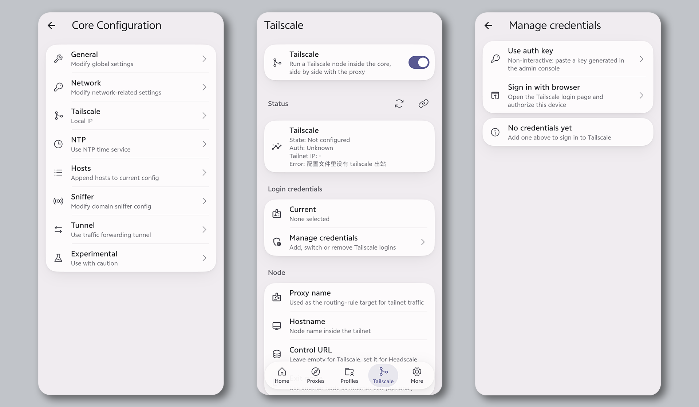

<h4 align="right">
  <a href="../README.md">简体中文</a> | <strong>English</strong> 
</h4>

<h1 align="center">⚡ BettboxMesh</h1>

  <strong>Another Better Network Toolbox (Mesh Network)</strong>

**Based on the [Bettbox](https://github.com/appshubcc/Bettbox) Android client branch, this version utilizes components such as Tailscale and ZeroTier—which are built into the Mihomo kernel—to implement networking functionality; all other features remain consistent with the upstream version.**

  

---

## 📃 Summary

* Since only one VpnService can exist on the Android system, it is not possible to use networking tools like Tailscale while the proxy software is running. BettboxMesh implements this functionality using components built into the Mihomo kernel.
* This project was developed entirely using Vibe Coding, so we cannot fully guarantee the quality and security of the code. We recommend reviewing the code before using it.
* Currently, only the Android platform is supported. Although the package name differs from the upstream [Bettbox](https://github.com/appshubcc/Bettbox) version, both can be installed simultaneously. Barring any unforeseen issues, updates will continue to be synchronized with the upstream version.
* For more information, please visit the [Bettbox](https://github.com/appshubcc/Bettbox) repository.

---

## 🛠️ Differences Relative to the Upstream

### 1. Built-in Tailscale
Compiled into the kernel as tsnet (userspace NetStack), it shares a single VpnService with the TUN proxy, eliminating the need to install the official Tailscale app.

- tailnet traffic (`100.64.0.0/10`, `fd7a:115c:a1e0::/48`, `*.ts.net`) is automatically routed to built-in nodes
- MagicDNS: `ts.net` domain names use tsnet's own DNS resolver
- Supports non-interactive login via Auth Key, browser-based authorization (OAuth), self-hosted Headscale, exit nodes, and subnet routers

**Direct connections only**. Tailscale’s control plane / DERP / WireGuard always use the physical network interface; they do not go through a proxy or a TUN connection. Reason: tsnet’s magicsock requires a generic UDP socket capable of freely sending packets, while mihomo’s proxydialer can only establish a UDP connection when the destination address is known; if connected this way, the node will not start.

### 2. Multi-Credential Management
You can save multiple Tailscale login credentials and switch between them at any time.

Each set of credentials has its own `state-dir`; switching between them changes the directory, so sessions do not interfere with one another. The core injects only one Tailscale outbound connection at a time, so this is a “save multiple, enable one” setup rather than simultaneous logins.

### First-Time Use
1. Install the APK and import your subscription (Profiles → Add Profiles → Import from a URL or other source), Turn on the VPN
2. Use the bottom navigation bar to go to **Tailscale** and toggle the switch on.
3. There are two ways to add login credentials:
    - **Auth Key**: Tailscale Dashboard → Settings → Keys → Generate auth key
    - **Browser Authorization**: After adding the credential entry, click the “Redirect” button to complete the authorization in your browser.
4. Return to the **Tailscale** page and wait a moment; the status card should display **“Running”** and an address in the format `100.x`.

Logging: The `log-level: silent` setting in the subscription overrides the app settings. If you need to view the logs, manually go to “Kernel Configuration → General → Log Level” and change it to Debug.

---

### ☕ Sponsoring & Support

**If you find this project helpful, you can also support its development through the following methods. Thank you very much.**

* Ethereum (ERC-20)： <code>0xc82f7a3a818590451ad68aaab12049924f5731d4</code>
* TRON (TRC-20)： <code>TBaQK2pTtRz3VyQ4XAeBxknbQ1t3wtSRLV</code>
* Bitcoin Cash (BCH)： <code>qpnrzamel8upj8e5fs5qg3dhd3ux5xtc5q2t07y222</code>
* Bitcoin (BTC)： <code>bc1pj8qphpkdy4rs86zxr2wwrx7svnqsn7retplsr2mkxjuqjlxej68qzn3srj</code>

---

### ✈️ Telegram Channel
**[BettboxMesh Channel](https://t.me/btmesh_channel)**

---

## ❤️ Acknowledgments

* **[Bettbox](https://github.com/appshubcc/Bettbox)**
* **[FlClash GUI](https://github.com/chen08209/FlClash)**
* **[Mihomo Core](https://github.com/MetaCubeX/mihomo)**
* **[DeepSeek Harness](https://github.com/deepseek-ai/deepseek-harness)**
* **[tailscale](https://github.com/metacubex/tailscale)**

---

## 📈 Project Popularity

  <a href="https://www.star-history.com/?repos=ovoCat%2FBettboxMesh&type=timeline&legend=top-left">
    <picture>
      <source media="(prefers-color-scheme: dark)" srcset="https://api.star-history.com/chart?repos=ovoCat/BettboxMesh&type=date&theme=dark&legend=top-left" />
      <source media="(prefers-color-scheme: light)" srcset="https://api.star-history.com/chart?repos=ovoCat/BettboxMesh&type=date&legend=top-left" />
      
    </picture>
  </a>

---

## 📄 License

This project is licensed under the [GPL-3.0 License](../LICENSE) 
